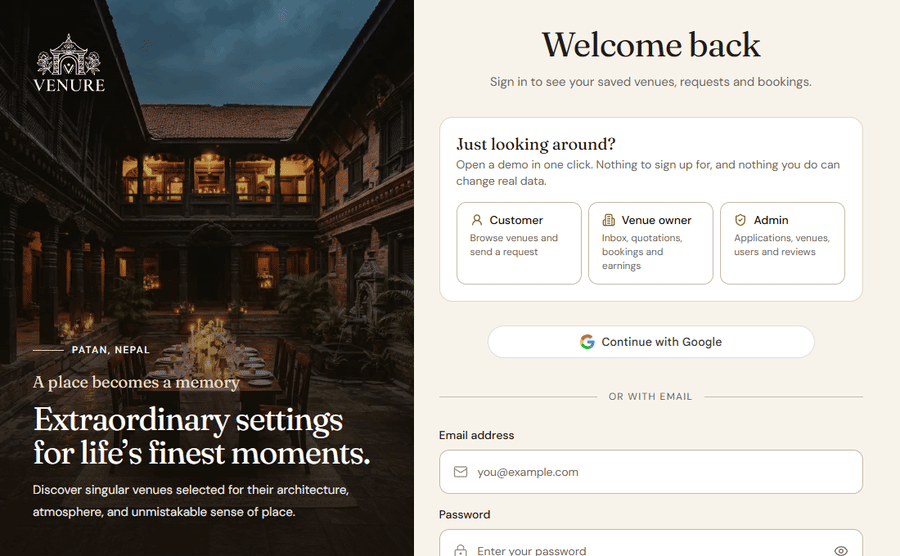
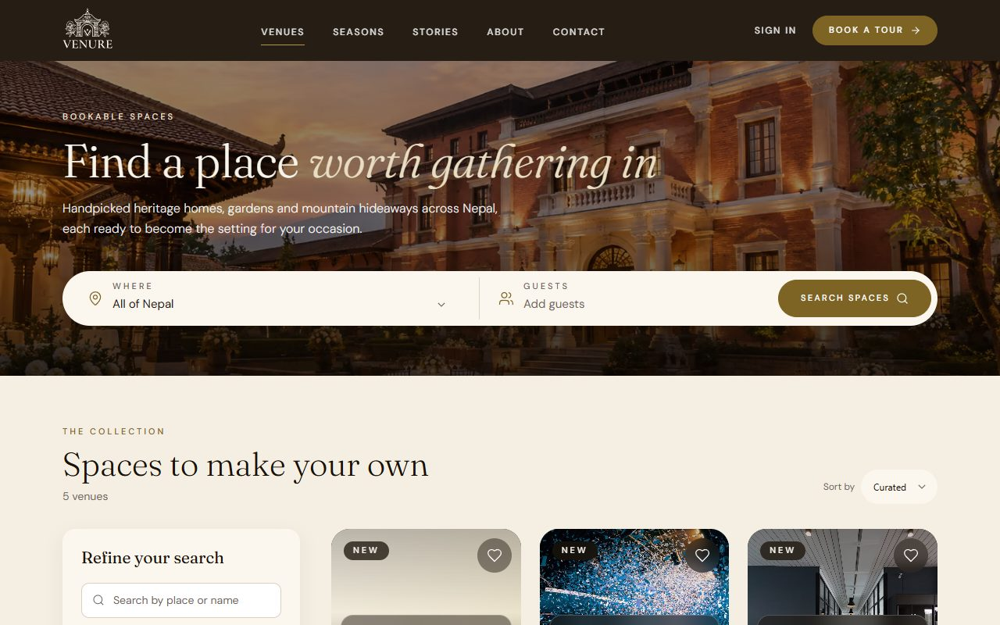
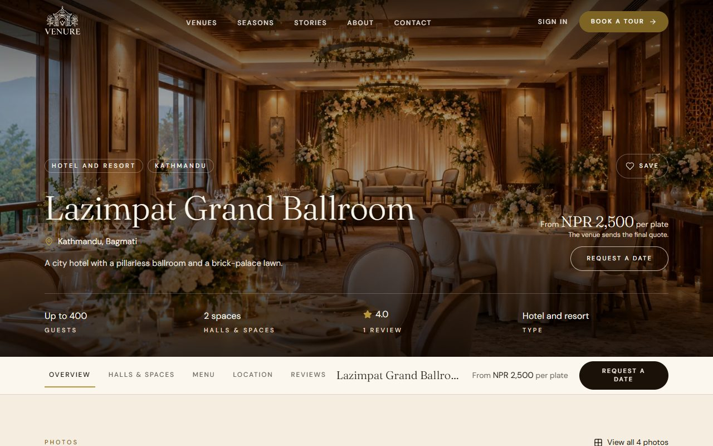
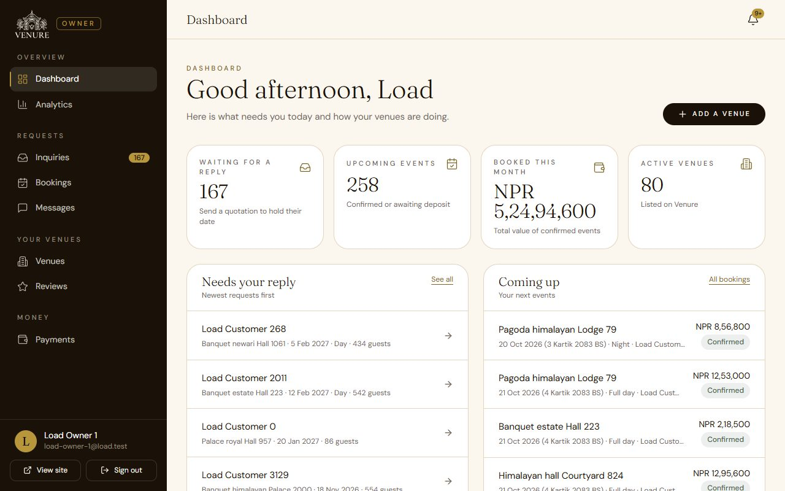
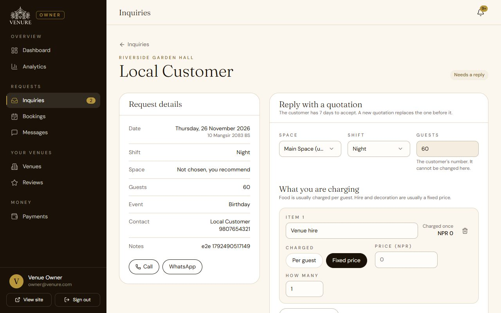
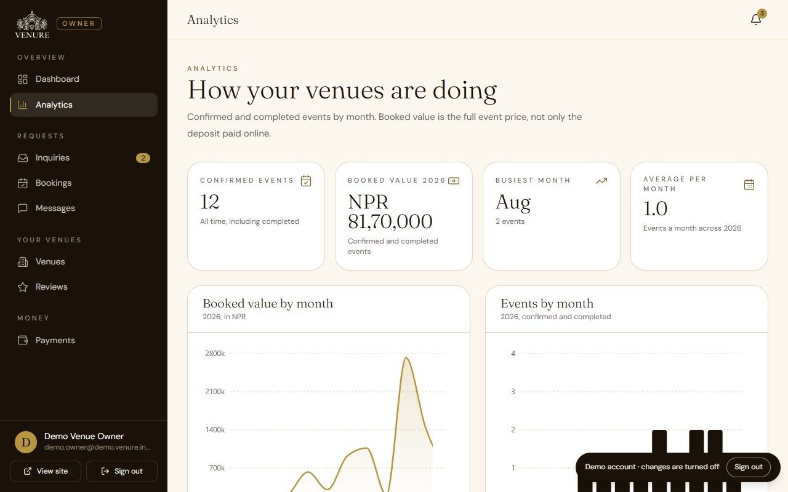
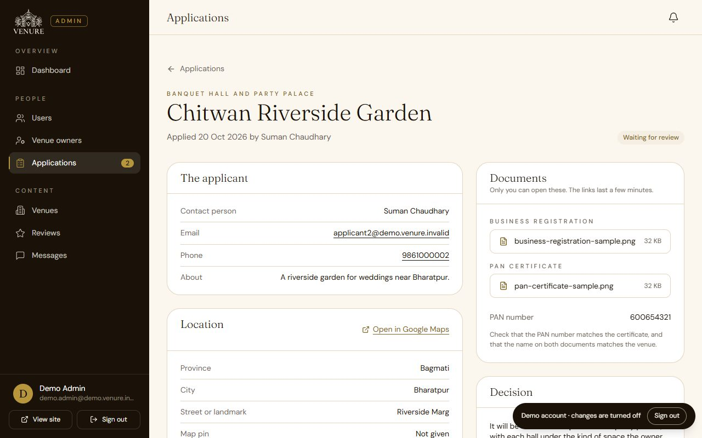

# 🏛️ Venure Frontend

[](https://github.com/AaryanBasnet/VenureFrontend/actions/workflows/ci.yml)

Venure is an event-venue platform for Nepal. Customers find a banquet hall, hotel or heritage venue, ask for a date and a shift, get a quotation from the venue, and confirm the booking by paying a deposit on eSewa. Venue owners apply to list, answer requests and run their bookings. Admins review applications and venues.

**Live site: [venure.aaryanbasnet.com.np](https://venure.aaryanbasnet.com.np)** · Backend: [VenureBackend](https://github.com/AaryanBasnet/VenureBackend)

This repository is the React frontend only. It talks to the backend over REST and Socket.IO.

> **Try it in one click:** open the [login page](https://venure.aaryanbasnet.com.np/login) and choose **Customer**, **Venue owner** or **Admin** under "Just looking around?". No sign-up. The owner and admin demos are read-only (the server enforces it), and the demo admin only ever sees demo data.

<p align="center"></p>

### At a glance

| | |
| --- | --- |
| **~1,700** automated tests across the stack | 365 unit (Vitest), 258 end-to-end (Playwright), 1,053 backend |
| **28 Playwright spec files** | Real browser, real backend: booking, quotations, chat, owner and admin areas, demo accounts, accessibility at phone width |
| **−70% to −86%** | Median latency of the booking and inquiry lists after server-side paging (with the backend) |
| **~20,000 lines** of React | Three roles: customer, venue owner, admin |
| **Lighthouse 94 desktop, 82 mobile** | Performance on the live home page; accessibility 100, best practices 96, SEO 100, layout shift 0 |
| **Bikram Sambat dates** | Nepali months and digits next to English, built into the calendar |

### Screenshots

| Find a venue | A venue page |
| --- | --- |
|  |  |
| **Owner dashboard** | **Reply with a quotation** |
|  |  |
| **Owner analytics** | **Admin: review an application** |
|  |  |

The screenshots come from the demo data. The venues, people and prices are made up, and the venue photos are AI-generated illustrations, not real places.

### Lighthouse

Measured on the live home page, median of three runs, 27 October 2026 (Lighthouse 12, its default throttling):

| | Performance | Accessibility | Best practices | SEO | Layout shift | First paint | Largest paint |
|---|---|---|---|---|---|---|---|
| Desktop | 94 | 100 | 96 | 100 | 0 | 0.9 s | 1.4 s |
| Mobile | 82 | 100 | 96 | 100 | 0 | 2.4 s | 4.1 s |

Before the performance work (20 October): desktop 76 and mobile 66, with a layout shift of 0.41 (the footer jumped when the page loaded), and a mobile largest paint of 6.0 s.

What changed: the loading placeholder is now a full screen tall so nothing moves when the page arrives, fonts are served from this site with metric-matched fallbacks, the chat library and animation code load only when needed, and data for sections below the fold waits until the page has painted.

Honest reading: mobile is still the weaker score, because Lighthouse runs it on a throttled phone and the main JavaScript bundle (React, axios, toasts) is the cost that is left. Getting it much higher would need pre-rendering the landing page, which is not done.

---

## ✨ How it works

Venure is built around how events are booked in Nepal, not around a shopping cart.

- **Inquiry, then quotation, then booking.** A customer sends a request (date, shift, hall, guests, event type). The venue replies with a quotation priced **per plate and per shift**, never per hour. The customer accepts it and pays a deposit on eSewa. The booking exists only once that payment is verified.
- **Shifts, not hours.** Day, night or full day. Dates are shown in English and Bikram Sambat (Nepali months and digits, English weekdays).
- **Halls.** A venue has one or more halls (heritage courtyards, garden estates, intimate halls, mountain retreats, rooftop terraces). A venue is one of three types: banquet or party palace, hotel or resort, heritage or traditional.
- **Owners apply, they do not sign up.** A venue owner applies with business documents and photos. An admin approves, and the owner gets an emailed link to set a password. The public sign-up page makes customers only.
- **Balance at the venue.** Only the deposit is paid online. The owner records the balance when the customer pays it at the venue.

## 🚀 Features

**Customers**
- Search and filter venues by city, type, kind of space, guests, amenities and price. Each venue page has a gallery, a map and its halls.
- Request a date from a calendar that shows what is taken and works from the keyboard.
- Attach menu files to a request, then accept or decline the quotation (with a reason).
- Pay the deposit on eSewa. See bookings as upcoming, past or cancelled, and cancel with the refund shown first.
- Chat with the venue, with live delivery and "Seen" ticks.
- Favorites, reviews, notifications, Google sign-in and password reset.
- A one-click demo for visitors: customer, venue owner and admin, read-only, with a banner that says so.

**Venue owners**
- Apply to list a venue (the draft survives a refresh), then manage venues, halls and hall photos.
- Inbox of requests with a quotation builder. Declining needs a reason.
- Bookings with deposit and balance: mark the balance settled, mark an event completed.
- Dashboard, payments, analytics, reviews and chat.

**Admins**
- Review venue applications and their private documents, approve or reject.
- Approve, reject and feature venues. Manage users and owners. Moderate reviews.

Booking, inquiry and chat lists are paged on the server, with the size of every tab.

## 🛠 Tech stack

React 19 · Vite 6 · Tailwind CSS v4 · TanStack Query · React Router · Zustand · Formik and Yup · Socket.IO client · Recharts · Framer Motion · nepali-date-converter · Vitest · Playwright

## ⚙️ Getting started

You need a recent Node.js (20 or newer) and the [backend](https://github.com/AaryanBasnet/VenureBackend) running.

```bash
git clone https://github.com/AaryanBasnet/VenureFrontend.git
cd VenureFrontend
npm install
cp .env.example .env.development.local   # then edit it
npm run dev
```

### Environment variables

| Variable | Needed | What it is |
| --- | --- | --- |
| `VITE_API_BASE_URL` | yes | The API, for example `http://localhost:5051/api` |
| `VITE_BACKEND_URL` | yes | The same server without `/api` (Socket.IO and uploaded files) |
| `VITE_GOOGLE_CLIENT_ID` | no | Google sign-in. Leave it blank and the button hides itself. It must match the backend's `GOOGLE_CLIENT_ID` |
| `VITE_CONTACT_EMAIL`, `VITE_CONTACT_PHONE`, `VITE_CONTACT_ADDRESS`, `VITE_CONTACT_HOURS` | no | Shown on the Contact page and footer. Any left empty is not shown |

## 📜 Scripts

| Command | What it does |
| --- | --- |
| `npm run dev` | Dev server |
| `npm run build` | Production build |
| `npm run lint` | ESLint |
| `npm run test:unit` | Vitest (365 tests) |
| `npm run test:e2e` | Playwright (258 tests in 28 files) |
| `npm run images:optimize` | Rebuild the landing-page images from the masters (see the script header) |

## 🧪 Testing

- **Unit (Vitest):** calendar and Bikram Sambat maths, shift and date handling, money formatting, venue filters, booking and inquiry helpers.
- **End to end (Playwright):** a real browser against a real backend. It covers browse and filters, the venue page, the inquiry form, quotations, booking and cancellation, chat, notifications, the owner and admin areas, routing and guards, and accessibility basics at phone width.
- The e2e suite needs a running backend and test accounts, given through environment variables (see `tests/helpers.js`). Specs that write data run in a fixed order after the read-only ones (`playwright.config.js`).
- **CI** runs lint and the production build on every push and pull request. The unit and e2e suites are run locally and are not part of CI yet.

## 📁 Project structure

```
src/
├── api/          # Axios calls, by area (owner, user, admin)
├── auth/         # AuthProvider, return to the page after sign-in
├── components/   # Shared UI (forms, dashboard shell, modals, previews)
├── features/     # bookings, favorites, inquiry, landing, listVenue, notifications, venues
├── hooks/        # Data hooks (TanStack Query) and chat
├── layouts/      # Public, owner and admin shells
├── lib/          # Socket.IO singleton
├── pages/        # user, venueOwner and admin pages
├── routers/      # Routes and guards
└── utils/
tests/            # Playwright specs
docs/             # design-system.md and CHANGELOG-MAJOR.md
```

## 🚀 Deployment

The site is served from Vercel (`vercel.json` rewrites every path to `index.html`). A `Dockerfile` and `nginx.conf` are included for a static container. Set the `VITE_*` variables in the hosting dashboard. Login cookies work best when the site and the API share a parent domain, see `docs/DEPLOY.md` in the backend.

## 📚 More

- [Design system](docs/design-system.md)
- [Major changes log](docs/CHANGELOG-MAJOR.md)

## 🚧 Known limits

- Payments run on eSewa's sandbox until live merchant keys are set on the backend. eSewa has no refund API, so refunds are recorded and paid back by hand.
- The owner area works but has not been redesigned yet.
- Performance on a throttled phone (mobile Lighthouse 82) could be higher; pre-rendering the landing page would be the next step.

## 📄 License

Source-available under the [PolyForm Noncommercial License 1.0.0](LICENSE). You can read, run and learn from the code. Commercial use is not allowed.

## 📬 Author

Aaryan Basnet · [basnetaryan1011@gmail.com](mailto:basnetaryan1011@gmail.com) · [LinkedIn](https://www.linkedin.com/in/basnet-aryan-4511a22a4/)
